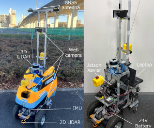
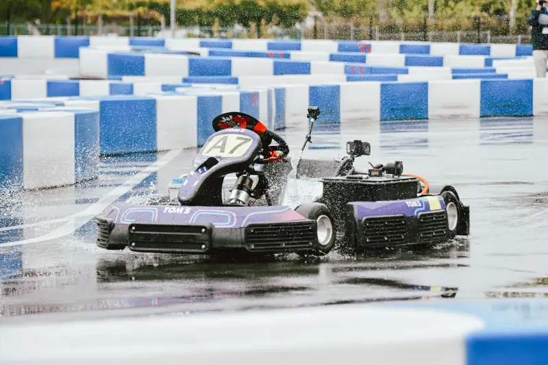

---
hide:
  - navigation
  - toc
---

START ─── WP01 ─── WP02 ─── GOAL

# 自律移動ロボットの 研究・開発

現在は、[つくばチャレンジ2026](https://tsukubachallenge.jp/2026/)に向けたロボットの開発をしている。

[研究を見る](tsukuba_2026/){ .md-button .md-button--primary }
[GitHub](https://github.com/yasumoto-dev){ .md-button }

  
AFFILIATION芝浦工業大学 工学部 電気ロボット工学コース

  
LABORATORY<a href="https://sites.google.com/shibaura-it.ac.jp/thase-frl">フィールドロボット研究室</a>

  
ADVISORS長谷川忠大 / 谷島諒丞

## 研究プロジェクト

  <a class="pr-card" href="tsukuba_2026/">
    
      
      PR01
    
    
      <strong>つくばチャレンジ2026</strong>
      <small>3D LiDAR / 2D LiDAR / GNSS / IMU / Jetson Xavier</small>
    
  </a>
  <a class="pr-card" href="aichallenge/">
    
      
      PR02
    
    
      <strong>自動運転AIチャレンジ2027</strong>
      <small>自動運転 / レーシングカート</small>
    
  </a>

