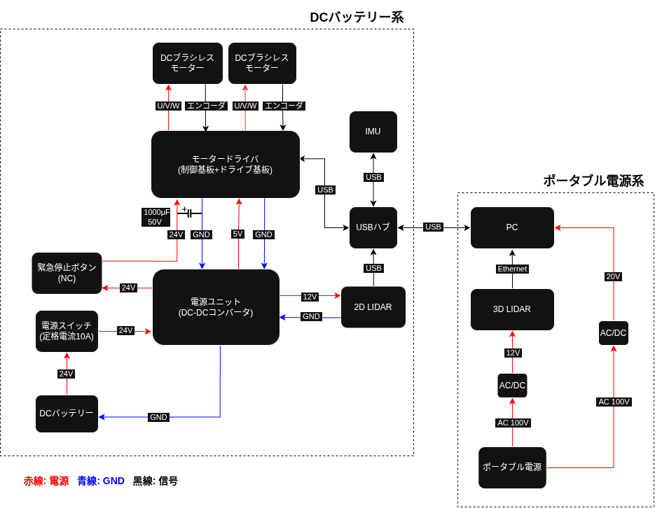

# つくばチャレンジ2026

> ハードウェアからソフトウェアまで一貫してチームでロボットを開発する。 
茨城県つくば市内で、自律移動ロボットを走行させて全長約2.2kmのコースの完走することが目標のプロジェクト。

## 1. 機体設計

CADで作成したアルミフレーム

---

## 2. 電装

主要な構成部品は以下の通りです。

|部品|メーカー|型番|
|--|--|--|
|ブラシレスDCモーター|T-frog|TF-M30-24-3500-G15L/R|
|モータードライバ|T-frog|TF-2MD3-R6|
|電源ユニット|T-frog|TF-PW36-5/12M|
|IMU|アールティー|USB出力9軸センサーモジュール|
|2D LIDAR|Hokuyo|UTM-30-LX-01|
|3D LIDAR|Velodyne|80-VLP-16-A|

簡単なシステム全体の配線図を示します。 

!!! question "LIDAR の役割"
    3D LIDAR は主にNDTスキャンマッチング用に使用し、 
    2D LIDAR は障害物検知をするためにロボットの下側にロール角を-180°して取り付けています。

---

## 3. ソフトウェア

ソフトウェア側は主に、自己位置推定モジュールと経路計画モジュールに分かれています。

障害物回避に関しては、現状A*を使っているため一度停止してから局所回避経路を引き直してから動作します。

そのため動作が遅く、ロボット同士のすれ違いなどはできていないため改良が必要と考えています。

???+ tip "自己位置推定"
    3D LIDAR によるNDTスキャンマッチングと、IMU,
    ホイールオドメトリをカルマンフィルタで融合することで自己位置を推定

???+ note "経路計画"
    経路計画に関しては、あらかじめ設定した waypoint
    を追従し、障害物があれば、A*アルゴリズムで局所経路計画をして回避
